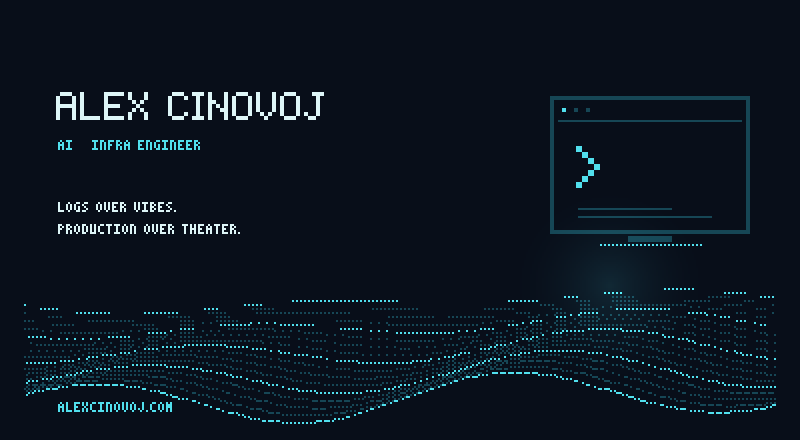

# Alex Cinovoj

AI & Infra Engineer. Building AI that survives outside the demo.

I build AI integrations, agent tooling, and workflow automation. My background is 13 years in US enterprise IT, including MSP work, systems engineering, and cloud infrastructure. That experience shapes how I approach automation: permissions, failure handling, and a clear path to recovery.

[Website](https://alexcinovoj.com) · [LinkedIn](https://linkedin.com/in/alexcinovoj) · [X](https://x.com/AlexCinovoj) · [Substack](https://alexcinovoj.substack.com/)

## What I work on

- AI agents and MCP integrations connected to real business systems.
- Workflow automation with human approvals, logs, and recovery paths.
- TypeScript, Python, React, Supabase, and cloud infrastructure.

## Selected open source

- **[Binnacle](https://github.com/TechTideOhio/binnacle)**  - Unified, zero-FFI, pure-Rust evaluator agent orchestrating the 15-tool TideOS evaluation stack across autonomous coding agents.
- **[ClawKeeper](https://github.com/Alexi5000/ClawKeeper)**  - Agent control plane built around policy checks, spending controls, and audit logs.
- **[CipherClaw](https://github.com/Alexi5000/CipherClaw)**  - TypeScript toolkit for investigating multi-agent runs, tracing errors, and inspecting failure paths.
- **[awesome-llm-apps](https://github.com/Shubhamsaboo/awesome-llm-apps)**  - Audited agent templates for production readiness, dependency hygiene, and fail-closed error handling.
- **[claude-code-templates](https://github.com/davila7/claude-code-templates)**  - Hardened loopback listener authentication, credential redaction in diagnostics, and sanitization of pipe-to-shell installer flows.
- **[9router](https://github.com/decolua/9router)**  - Upstream routing patches and Cloudflare AI multi-modal reference image forwarding.
- **[agent-lightning](https://github.com/microsoft/agent-lightning)**  - Fixed memory leaks by pruning superseded routed experts across multi-turn trajectories.
- **[vibe-kanban](https://github.com/BloopAI/vibe-kanban)**  - Evaluated real-time multi-repo agent task board orchestration with Tauri and SPAKE2.

<b>The TideOS 15-Tool Eval Stack</b> (click to expand)

| Step | Engine | Focus |
|---|---|---|
| 01 | [reval](https://github.com/TechTideOhio/reval)  | Error analysis & causal Bayesian trace DAGs |
| 02 | [gild](https://github.com/TechTideOhio/gild)  | Stratified golden dataset authoring & lockfiles |
| 03 | [tessel](https://github.com/TechTideOhio/tessel)  | Synthetic covering arrays ($P \times I \times C \times E$) |
| 04 | [assay](https://github.com/TechTideOhio/assay)  | Deterministic assertions & pure-Rust DB/RLS |
| 05 | [tide-rill](https://github.com/TechTideOhio/tide-rill)  | Retrieval vs generation & faithfulness gating |
| 06 | [keel](https://github.com/TechTideOhio/keel)  | Trajectory scoring & 14-step cost/latency bug detection |
| 07 | [temper](https://github.com/TechTideOhio/temper)  | pass@k vs pass^k multi-trial reliability |
| 08 | [parley](https://github.com/TechTideOhio/parley)  | Multi-turn simulated users & sycophancy tests |
| 09 | [gavel](https://github.com/TechTideOhio/gavel)  | LLM judge calibration & Rogan-Gladen debiasing |
| 10 | [poise](https://github.com/TechTideOhio/poise)  | Double-blind order-swapped pairwise adjudication |
| 11 | [plumb](https://github.com/TechTideOhio/plumb)  | SplitMix64 bootstrap CIs & exact McNemar tests |
| 12 | [weir](https://github.com/TechTideOhio/weir)  | Fail-closed per-category CI regression gating |
| 13 | [eddy](https://github.com/TechTideOhio/eddy)  | Online production sampling & CUSUM drift alerts |
| 14 | [tare](https://github.com/TechTideOhio/tare)  | CPST (Cost Per Successful Task) & Pareto release gates |
| 15 | [tether](https://github.com/TechTideOhio/tether)  | Failure harvesting, SimHash dedupe & release replay |

## How I work

I keep permissions narrow, make failures visible, and document how to operate what I build. I prefer a small system a team can maintain over a complicated one nobody owns.

## Background & community

Founder & CTO, [TechTide AI](https://techtideai.io) · CTO & Co-Founder, CPG Playbook

I also support developer communities as a [Lovable](https://github.com/lovablelabs) Senior Champion and Ambassador, and a Discord moderator at [TypeSafe AI](https://github.com/typesafe-ai).

[Work with me](https://techtideai.io/contact) · [Email](mailto:alex@techtideai.io)

Logs over vibes. Production over theater.

[Contributing](CONTRIBUTING.md) · [Support](SUPPORT.md) · [Security](SECURITY.md)
