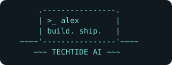

# Alex Cinovoj

AI & Infra Engineer. Building AI that survives outside the demo.

I build AI integrations, agent tooling, and workflow automation. My background is 13 years in US enterprise IT, including MSP work, systems engineering, and cloud infrastructure. That experience shapes how I approach automation: permissions, failure handling, and a clear path to recovery.

[Website](https://alexcinovoj.com) · [Technical work](https://alexcinovoj.dev) · [LinkedIn](https://linkedin.com/in/alexcinovoj) · [X](https://x.com/AlexCinovoj) · [Substack](https://alexcinovoj.substack.com/)

## What I work on

- AI agents and MCP integrations connected to real business systems.
- Workflow automation with human approvals, logs, and recovery paths.
- TypeScript, Python, React, Supabase, and cloud infrastructure.

## Selected open source

**[ClawKeeper](https://github.com/Alexi5000/ClawKeeper)**  
An agent control plane built around policy checks, spending controls, and audit logs.

**[CipherClaw](https://github.com/Alexi5000/CipherClaw)**  
A TypeScript toolkit for investigating multi-agent runs, tracing errors, and inspecting failure paths.

## How I work

I keep permissions narrow, make failures visible, and document how to operate what I build. I prefer a small system a team can maintain over a complicated one nobody owns.

## Background & community

Founder & CTO, [TechTide AI](https://techtideai.io) · CTO & Co-Founder, CPG Playbook

I also support developer communities as a [Lovable](https://github.com/lovablelabs) Senior Champion and Ambassador, and a Discord moderator at [TypeSafe AI](https://github.com/typesafe-ai).

[Work with me](https://techtideai.io/contact) · [Email](mailto:alex@techtideai.io)

Logs over vibes. Production over theater.

[Contributing](CONTRIBUTING.md) · [Support](SUPPORT.md) · [Security](SECURITY.md)
